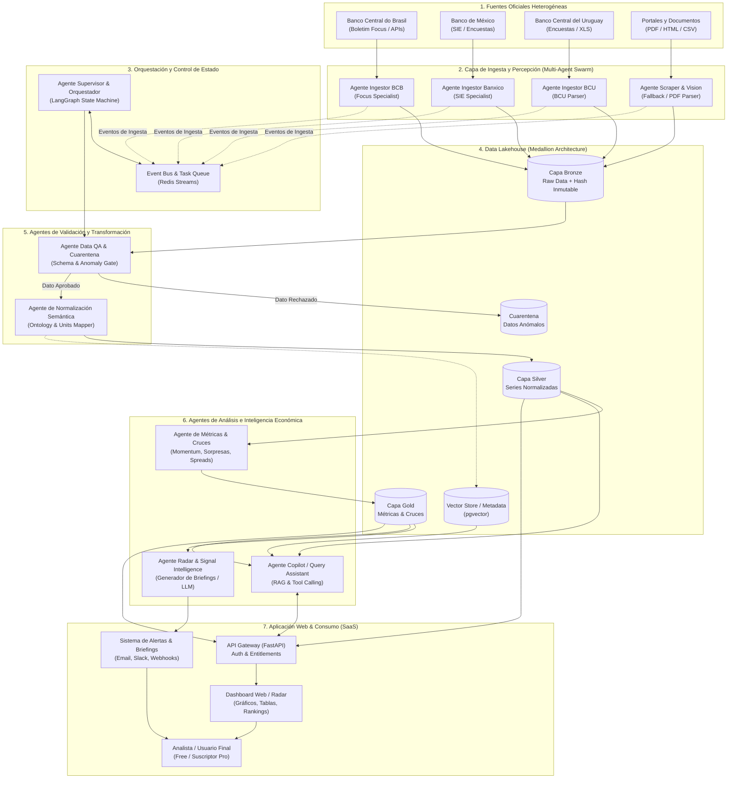
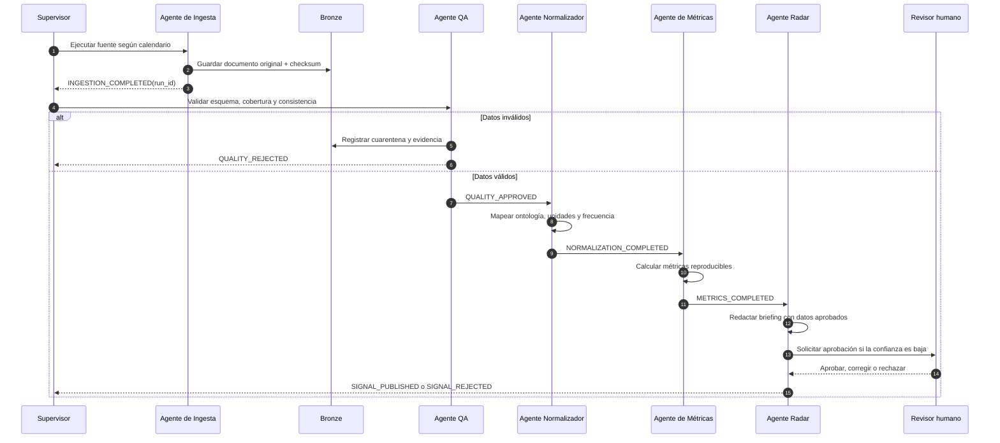

# Arquitectura de Sistemas Multiagente (MAS) para LEIP

## LatAm Economic Intelligence Platform

**Documento Técnico y de Diseño de Arquitectura**  
**Proyecto:** LEIP (LatAm Economic Intelligence Platform)  
**Institución:** Universidad Católica del Uruguay — Facultad de Ingeniería y Tecnologías  
**Carrera:** Ingeniería en Informática  
**Fecha:** Septiembre 2026

---

## 1. Resumen Ejecutivo y Motivación

LEIP (**LatAm Economic Intelligence Platform**) tiene como objetivo central resolver la fragmentación y heterogeneidad de los datos macroeconómicos oficiales de América Latina (iniciando con Brasil, México y Uruguay en el MVP). Las fuentes oficiales publican en una amplia variedad de formatos (APIs, Excel, CSV, PDFs no estructurados, tablas HTML, JSON) y con frecuencias dispares (semanal, quincenal, mensual).

La integración de una **Arquitectura Basada en Sistemas Multiagente (MAS - _Multi-Agent Systems_)** permite desacoplar la complejidad de extracción, limpieza, conciliación semántica, análisis econométrico y generación de inteligencia en entidades autónomas, especializadas y cooperativas. Cada agente opera con un ámbito de responsabilidad acotado (_Single Responsibility Principle_), interactuando a través de protocolos formales de comunicación y un bus de eventos / memoria compartida (_Blackboard Pattern_).

---

## 2. Tecnologías y Stack Recomendado ("¿Qué usaríamos?")

Para garantizar mantenibilidad, escalabilidad, trazabilidad y reproducibilidad académica e industrial, se propone el siguiente stack tecnológico:

| Capa / Componente                           | Tecnología Seleccionada                                              | Justificación Técnica                                                                                                                                                                     |
| :------------------------------------------ | :------------------------------------------------------------------- | :---------------------------------------------------------------------------------------------------------------------------------------------------------------------------------------- |
| **Framework Multiagente**                   | **LangGraph** (Python)                                               | Orquestación basada en grafos cíclicos de estado (StateGraph), soporte nativo de persistencia de estados (_checkpointers_), branching condicional y control estricto _Human-in-the-Loop_. |
| **Modelos Fundacionales (LLMs)**            | **GPT-4o / Claude 3.5 Sonnet + Modelos Ligeros (Llama 3 / Mistral)** | LLMs avanzados para extracción estructurada de reportes complejos (PDFs de bancos centrales) y síntesis económica; modelos más ligeros para clasificación rápida de señales.              |
| **Ingesta y Parsing de Fuentes**            | **Polars + Playwright + Unstructured / PDFPlumber**                  | Extracción robusta de portales dinámicos (SPA del BCB o Banxico), lectura de hojas de cálculo heterogéneas y extracción de tablas en documentos oficiales.                                |
| **Capa de Almacenamiento (Data Lakehouse)** | **PostgreSQL + TimescaleDB + MinIO (S3 compatible)**                 | Arquitectura Medallion (_Bronze_ para datos crudos inmutables con checksums, _Silver_ para series históricas normalizadas y _Gold_ para métricas y cruces).                               |
| **Memoria Semántica & Vector Store**        | **pgvector / Qdrant**                                                | Indexación y recuperación de notas metodológicas, minutas de comités de política monetaria y metadatos contextuales.                                                                      |
| **Bus de Mensajería & Cache de Estado**     | **Redis (Streams + Pub/Sub)**                                        | Comunicación asíncrona entre agentes, gestión de colas de tareas de ingesta y caché de respuestas del dashboard.                                                                          |
| **API Backend & Servidor de Aplicación**    | **FastAPI (Python)**                                                 | Exposición de endpoints REST y GraphQL para el Frontend (Dashboard SaaS, Radar de Expectativas y Auth/Entitlements).                                                                      |

### 2.1. Criterio de uso de agentes y modelos generativos

La arquitectura no convierte cada tarea en una conversación con un LLM. En LEIP, un agente es un componente autónomo con una responsabilidad, herramientas permitidas, estado y reglas de decisión definidos. Las operaciones que deben ser exactas, repetibles y auditables se implementan como código determinista; el LLM se utiliza únicamente cuando aporta valor en interpretación de documentos, clasificación o redacción.

| Tipo de trabajo                                                      | Implementación recomendada           | Motivo                                                       |
| :------------------------------------------------------------------- | :----------------------------------- | :----------------------------------------------------------- |
| Descarga, checksum, validación de esquema y cálculos                 | Workers Python/Polars                | Evita variabilidad y permite reproducir el resultado.        |
| Interpretación de PDF, detección de tablas y clasificación semántica | Agente con LLM y salida estructurada | Resuelve variaciones de formato y lenguaje natural.          |
| Métricas económicas, rankings y cruces                               | Librería estadística versionada      | Un LLM no debe decidir valores numéricos.                    |
| Explicaciones y briefings                                            | Agente generativo con RAG            | Redacta sobre métricas ya aprobadas, citando su procedencia. |

La decisión de publicar pertenece al sistema de reglas y al control de calidad. Un agente generativo puede proponer una interpretación, pero no puede modificar directamente las capas Silver o Gold ni publicar un dato sin pasar las validaciones definidas.

---

## 3. Catálogo y Roles de los Agentes del Sistema

```
                      ┌─────────────────────────────────────────┐
                      │    Supervisor & Orchestrator Agent      │
                      └────────────────────┬────────────────────┘
                                           │
         ┌─────────────────────────────────┼─────────────────────────────────┐
         ▼                                 ▼                                 ▼
┌──────────────────┐             ┌──────────────────┐              ┌──────────────────┐
│ Ingestion Agents │             │ Processing Agents│              │ Analytical Agents│
│  - BCB Agent     │             │  - QA/Quarantine │              │  - Metrics Agent │
│  - Banxico Agent │             │  - Norm/Semantic │              │  - Signal/Radar  │
│  - BCU Agent     │             │    Agent         │              │    Agent         │
│  - Scraper Agent │             │                  │              │  - Copilot Agent │
└──────────────────┘             └──────────────────┘              └──────────────────┘
```

### 3.1. Agentes de Percepción e Ingesta (Ingestion Agents)

- **Agente Ingestor BCB (Brasil):** Monitorea y extrae periódicamente los microdatos y series del Boletín Focus y la API del Banco Central do Brasil.
- **Agente Ingestor Banxico (México):** Gestiona la consulta a los servicios SIE y encuestas de expectativas quincenales/mensuales del Banco de México.
- **Agente Ingestor BCU (Uruguay):** Extrae las planillas y publicaciones de la encuesta de expectativas de inflación y actividad del Banco Central del Uruguay.
- **Agente de Scraping & Parsing Estructurado:** Maneja la extracción desde páginas web dinámicas y documentos PDF/HTML no estructurados cuando las APIs oficiales no están disponibles o sufren cambios.

### 3.2. Agentes de Procesamiento y Validación

- **Agente de Control de Calidad y Cuarentena (Data QA & Quarantine Agent):** Evalúa la integridad estructural, detecta valores atípicos (_outliers_), faltantes de datos o quiebres de esquema. Si los datos no cumplen las reglas de validación, los envía al bucket de cuarentena y genera una alerta operativa.
- **Agente de Normalización y Ontología Macroeconómica (Semantic Normalization Agent):** Convierte unidades (%, p.b., índices, monedas locales), estandariza frecuencias (anualizada, mensual, punta a punta) y alinea horizontes temporales (año corriente, año próximo, 12 meses adelante) contra el modelo de datos común (Capa Silver).

### 3.3. Agentes Analíticos y de Inteligencia

- **Agente de Métricas y Cruces Econométricos (Metrics Engine Agent):** Calcula el momentum de expectativas, distancias a metas de inflación, sorpresas estadísticas y divergencias entre países de forma determinista y reproducible (Capa Gold).
- **Agente de Señales y Radar de Expectativas (Signal & Radar Intelligence Agent):** Analiza los movimientos calculados, detecta cambios de régimen o quiebres de tendencia, y genera los resúmenes ejecutivos e informes analíticos del "Radar de Expectativas" utilizando LLMs guiados por plantillas semánticas y trazabilidad estricta.
- **Agente Asistente Conversacional (LEIP Query Copilot Agent):** Atiende consultas interactivas de analistas en lenguaje natural dentro del dashboard, consultando el catálogo de series y respetando las reglas de acceso (_entitlements_) según el plan del usuario (Free vs Pro).

### 3.4. Agente Coordinador (Supervisor & Orchestrator Agent)

- Supervisa los flujos de trabajo (_DAGs_), planifica las tareas cronometradas según los calendarios de publicación de cada banco central, gestiona los reintentos ante fallas y consolida los estados de ejecución.

### 3.5. Capacidades compartidas de los agentes

Todos los agentes deben implementar una interfaz común y no acceder libremente a la base de datos. El acceso se realiza mediante herramientas autorizadas (_tools_) y contratos versionados.

- **Identidad:** `agent_id`, versión del agente y versión de su configuración.
- **Estado:** `run_id`, `correlation_id`, país, fuente, periodo y estado de la tarea.
- **Herramientas:** cliente HTTP, lector de archivos, repositorio Bronze, catálogo de series, motor de métricas o servicio de notificaciones.
- **Políticas:** tiempo máximo, cantidad de reintentos, dominios permitidos, límites de costo y nivel requerido de aprobación humana.
- **Evidencia:** entrada utilizada, salida producida, reglas aplicadas, checksum y fecha de ejecución.

La separación de estas capacidades permite reemplazar un agente o un proveedor de modelos sin modificar el contrato del resto del sistema.

---

## 4. Diagrama de Arquitectura Multiagente



### 4.1. Flujo de ejecución de una actualización



---

## 5. Patrón de Coordinación y Protocolo de Comunicación

1. **Patrón de Arquitectura:** Combinación de **Supervisor-Worker** para la ejecución de flujos de datos deterministas (ETL y cálculo de métricas) y **Blackboard Pattern (Pizarra Compartida)** sobre Redis/Postgres para que los agentes analíticos inspeccionen el estado global de las variables económicas y colaboren en la generación del Radar de Expectativas.
2. **Ciclo de Ejecución (Event-Driven):**
   - El _Agente Supervisor_ activa los _Agentes Ingestores_ según el calendario macroeconómico oficial.
   - Tras almacenar el payload original en la capa _Bronze_ con su correspondiente checksum, se emite el evento `INGESTION_COMPLETED`.
   - El _Agente QA_ consume el evento, aplica validaciones matemáticas y lógicas (rangos plausibles, no negatividad en tasas nominales salvo escenarios particulares, continuidad de series).
   - El _Agente de Normalización_ proyecta los datos validados a la capa _Silver_.
   - El _Agente de Métricas_ calcula los indicadores analíticos (momentum, distancia a meta de inflación, percentil de 5 años) y escribe en la capa _Gold_.
   - El _Agente de Radar_ detecta divergencias relevantes y redacta los briefings analíticos listos para el consumo de los usuarios.

---

## 6. Ventajas del Enfoque Multiagente para LEIP

1. **Resiliencia ante Cambios de Formato:** Si un banco central altera su API o estructura de archivos, únicamente se actualiza o reentrena la herramienta del agente específico sin afectar al resto del sistema.
2. **Separación de Responsabilidades y Determinismo:** Las operaciones matemáticas y los cálculos econométricos son ejecutados por agentes algorítmicos deterministas (código Python/Polars puro), mientras que los LLMs se reservan exclusivamente para la síntesis cualitativa, explicación y traducción de lenguaje natural.
3. **Auditabilidad y Trazabilidad Total:** Cada dato publicado en el Dashboard mantiene la cadena de custodia: qué agente lo extrajo, qué regla de normalización se aplicó, qué versión de la fuente original corresponde y cuál fue el hash de validación QA.
4. **Escalabilidad Modular:** La adición de nuevos países (ej. Chile, Colombia, Perú) solo requiere instanciar un nuevo _Ingestion Agent_ configurado con la ontología y fuente del nuevo país.

---

## 7. Contratos de datos y eventos

La cooperación entre agentes debe basarse en mensajes explícitos, idempotentes y versionados. No se recomienda enviar texto libre entre agentes cuando el resultado pueda expresarse como datos estructurados.

### 7.1. Evento de ingesta completada

```json
{
  "event_type": "INGESTION_COMPLETED",
  "schema_version": "1.0",
  "run_id": "run-2026-09-04-bcb-001",
  "correlation_id": "corr-8f31",
  "source": {
    "country": "BR",
    "institution": "BCB",
    "dataset": "focus_expectations",
    "published_at": "2026-09-04T12:00:00Z"
  },
  "artifact": {
    "uri": "bronze/bcb/focus/2026-09-04.json",
    "checksum": "sha256:...",
    "format": "json"
  },
  "producer": {
    "agent_id": "bcb-ingestor",
    "agent_version": "1.0.0"
  }
}
```

### 7.2. Reglas del contrato

1. Un mismo `run_id` no puede publicar dos resultados distintos en la misma versión de datos.
2. Cada consumidor debe poder reintentar el evento sin duplicar registros (_idempotencia_).
3. Los cambios incompatibles incrementan `schema_version` y se mantienen adaptadores para versiones anteriores.
4. Los mensajes no contienen secretos ni datos de autenticación.
5. Todo evento termina en `COMPLETED`, `REJECTED` o `FAILED`, con motivo y evidencia.

---

## 8. Seguridad, gobierno y control de acceso

La arquitectura multiagente introduce permisos adicionales porque los agentes pueden consultar fuentes, escribir datos y llamar modelos externos. Por ello se aplican los siguientes controles:

- **Mínimo privilegio:** cada agente tiene permisos solamente sobre sus fuentes, herramientas y capas de almacenamiento.
- **Separación de capas:** Bronze es inmutable; Silver y Gold solo se actualizan mediante servicios versionados.
- **Secretos:** API keys y credenciales se almacenan en un gestor de secretos, nunca en prompts, eventos o repositorios.
- **Entitlements:** el API Gateway verifica usuario, organización, plan, país y módulo antes de servir datos o invocar el Copilot.
- **Trazabilidad:** se registra quién solicitó una consulta, qué herramientas fueron utilizadas, qué series se recuperaron y qué versión de datos respondió.
- **Fuentes autorizadas:** el Scraper solo puede acceder a dominios definidos en un catálogo y respeta las condiciones de uso de cada organismo.
- **Aprobación humana:** se requiere revisión para cambios de esquema, baja confianza de extracción, señales de impacto alto y modificaciones de reglas metodológicas.

El texto generado por el Radar o el Copilot se considera una vista derivada. La fuente de verdad sigue siendo la serie normalizada, sus metadatos y las métricas deterministas.

---

## 9. Observabilidad y criterios de calidad

El Supervisor debe producir métricas técnicas y funcionales por cada ejecución:

| Dimensión        | Indicadores sugeridos                                                                     |
| :--------------- | :---------------------------------------------------------------------------------------- |
| Disponibilidad   | porcentaje de ejecuciones exitosas por fuente y tiempo de recuperación.                   |
| Calidad          | registros aceptados, rechazados, faltantes, duplicados y cambios de esquema.              |
| Frescura         | demora entre publicación oficial, ingesta y disponibilidad en el dashboard.               |
| Reproducibilidad | porcentaje de resultados reconstruibles usando el mismo `run_id` y versión.               |
| Costos           | tokens, tiempo de ejecución y llamadas externas por agente.                               |
| Inteligencia     | señales confirmadas, señales rechazadas y porcentaje de briefings con evidencia completa. |

Cada ejecución debe disponer de logs estructurados, trazas distribuidas y un enlace al artefacto original. Una alerta no se considera válida si no puede explicar qué métrica cambió, contra qué periodo se comparó y de qué fuente provino.

---

## 10. Implementación incremental para el MVP

Se recomienda desarrollar el sistema en etapas, evitando desplegar todos los agentes al comienzo.

| Fase                  | Alcance                                                               | Resultado verificable                                          |
| :-------------------- | :-------------------------------------------------------------------- | :------------------------------------------------------------- |
| 1. Núcleo de datos    | BCB, Banxico y BCU; Bronze, Silver; contratos de eventos y checksum.  | Series normalizadas con procedencia y pruebas de idempotencia. |
| 2. Calidad y métricas | QA, cuarentena, métricas deterministas y Gold.                        | Dashboard con históricos, revisiones y cruces reproducibles.   |
| 3. Supervisor         | Calendarios, reintentos, estados y observabilidad.                    | Ejecuciones automáticas recuperables y auditables.             |
| 4. Inteligencia       | Radar generativo con RAG, plantillas, evaluación y aprobación humana. | Briefing respaldado por métricas y fuentes citables.           |
| 5. Copilot            | Consultas limitadas a herramientas de lectura y entitlements.         | Respuestas con series, periodo, fuente y advertencias.         |
| 6. Expansión          | Nuevos países, fuentes y módulos de precios/actividad.                | Nuevos conectores sin modificar el núcleo de normalización.    |

El primer entregable no necesita una colonia de agentes completamente autónomos. Un Supervisor con workers especializados y dos agentes generativos controlados es suficiente para validar la hipótesis del proyecto: que la especialización mejora la incorporación, trazabilidad y análisis de fuentes económicas heterogéneas.

---

## 11. Riesgos y mitigaciones

| Riesgo                          | Consecuencia                                        | Mitigación                                                                                    |
| :------------------------------ | :-------------------------------------------------- | :-------------------------------------------------------------------------------------------- |
| Sobreutilización de LLMs        | Resultados costosos o no reproducibles.             | LLM solo en extracción ambigua y redacción; métricas en código determinista.                  |
| Cambio de formato de una fuente | Ingesta detenida o datos incorrectos.               | Pruebas de contrato, versionado de conectores, cuarentena y alertas.                          |
| Alucinación en el Radar         | Interpretación económica sin respaldo.              | RAG restringido, citas obligatorias, validación de cifras y aprobación humana.                |
| Duplicación de eventos          | Series o métricas repetidas.                        | `run_id`, checksum, claves únicas e idempotencia.                                             |
| Dependencia de un proveedor     | Aumento de costos o bloqueo tecnológico.            | Adaptador de modelo, prompts versionados y modelo alternativo para tareas simples.            |
| Acceso indebido por el Copilot  | Exposición de módulos contratados o datos internos. | Herramientas de solo lectura, verificación de entitlements antes de cada llamada y auditoría. |

---

## 12. Decisión arquitectónica final

Para LEIP se recomienda una **arquitectura multiagente híbrida, dirigida por eventos y coordinada por un Supervisor**. Los conectores de fuentes, la validación, la normalización y los cálculos conforman agentes especializados con comportamiento determinista. El uso de modelos generativos queda acotado al parsing de documentos ambiguos, la clasificación semántica y la redacción de explicaciones basadas en evidencia.

Esta decisión mantiene las ventajas de un MAS —especialización, cooperación, extensibilidad y autonomía operativa— sin sacrificar los requisitos centrales de LEIP: comparabilidad, trazabilidad, control de versiones, reproducibilidad y confianza en la información económica publicada.
